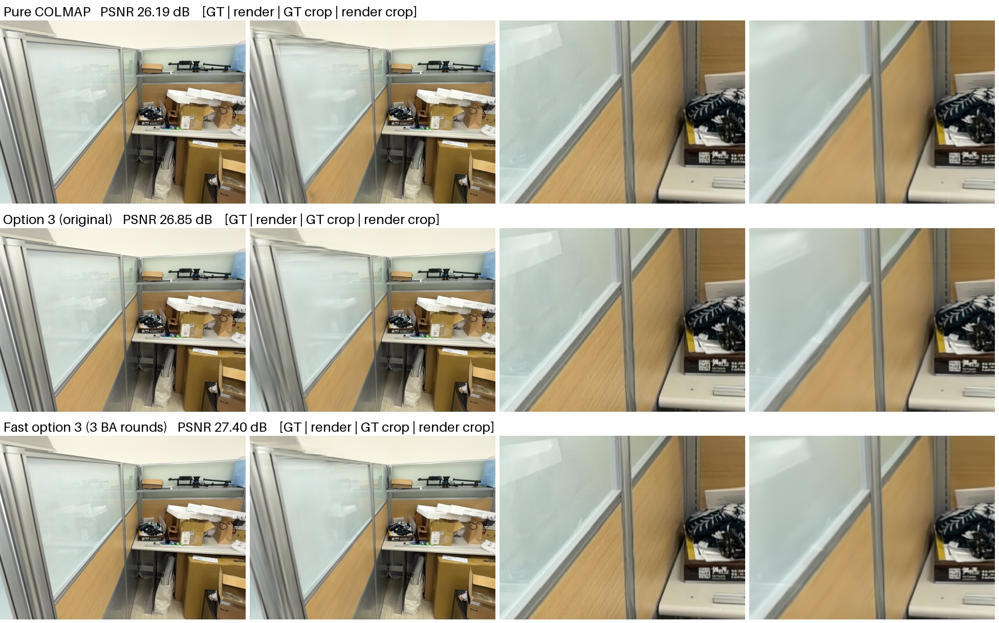
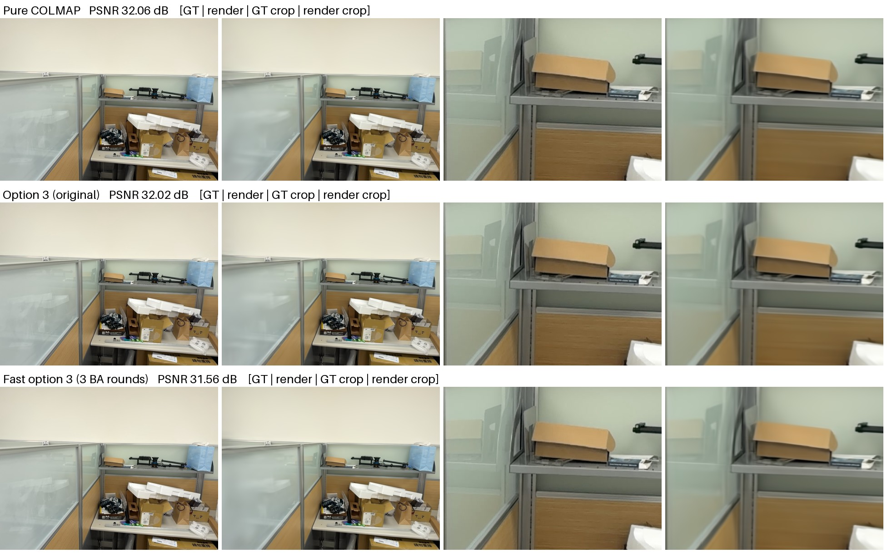
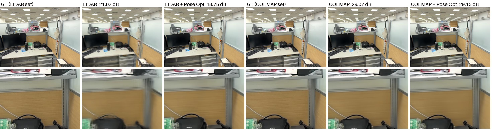
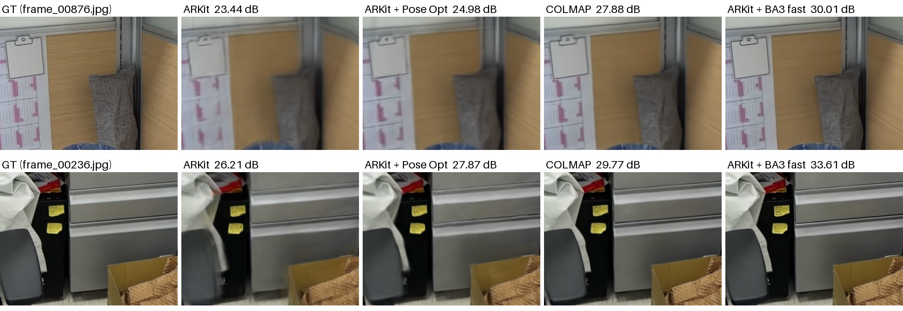
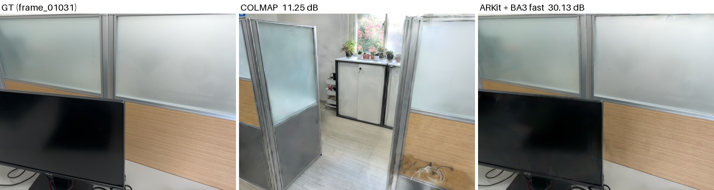

# Benchmark

**English** | [繁體中文](benchmark.zh-TW.md)

## About this data

These are the author's own experiments, run while the tool was developed in October 2026. The scans themselves are not published. This section explains how they were captured and evaluated, so that the numbers can be read correctly and the evaluation can be repeated on your own data.

### Scans

| | Scan 1 (first scan) | Scan 2 (second scan) |
|---|---|---|
| ID | `scan_20261014_122607_B9A64C` | `scan_20261016_154038_063C40` |
| Used in | Sections 1–7 and 9 | Sections 8 and 9 |
| Scene | indoor office | the same office |
| Phone | iPhone 18 Pro (`iPhone19,2`), iOS 27.0.1 | the same phone |
| Capture app | [Splatify-Anything](https://github.com/KuoFengYuan/splatify-anything), walking through the room while it records | the same app |
| Images | 1920×1440; 749 captured, 729 kept with a pose | 1920×1440; 1,562 captured, 1,505 kept with a pose |
| Capture time | 121 s | 237 s |
| Poses | ARKit tracking, refined on the device by the capture app | the same |
| 3D points | an external Livox Mid-360 LiDAR on the same handheld rig (250,000 points) | the iPhone's built-in LiDAR (228,736 points) |
| Focus | locked (fx varies by 0.13%) | not locked (fx varies by 2.2%; see Section 8.2) |

The capture app drops images it cannot pose; only the posed images are used.

### What the rows mean

- **Raw ARKit poses** (also "raw ARKit/LiDAR poses"): training directly on the scan as exported. Its `sparse/0` holds the ARKit track after the app's on-device refinement, which differs from the ARKit track itself by a median of 4 mm (scan 1) and 24 mm (scan 2).
- **ARKit + LichtFeld Pose Opt**: the same data, with camera-pose optimisation during training. Pose Opt is a local modification of LichtFeld Studio that is not part of its releases; the row is for reference only.
- **COLMAP from scratch**: COLMAP's own pipeline (vocabulary-tree matching and global_mapper) on the same images, without the input poses.
- **v1**: the 10/15 version of this tool. OPENCV camera model; each BA round runs until COLMAP's default convergence criteria are met.
- **v2**: the 10/16 version, which is the current default. RAD_TAN_THIN_PRISM_FISHEYE camera model, BA capped at 15 iterations, 2 refinement passes inside triangulation.

### Evaluation setup

- **Training:** LichtFeld Studio, MRNF strategy, 30,000 iterations, `--max-cap 1000000`.
- **Test images:** after sorting by file name, every 8th image is a test image (92 of 729 for scan 1, 189 of 1,505 for scan 2), identical for all configurations. PSNR/SSIM/LPIPS are averages over the test images. Section 9.2 also uses a separate held-out split, described there.
- **Noise:** training twice on the same dataset changes PSNR by only about 0.01 dB. Re-running the whole COLMAP pipeline and then training changes it by about 0.05–0.09 dB (v1 was 28.448 on 10/15 and 28.395 when re-run with the pipeline script on 10/16; two independent v2 runs on the first scan gave 30.844 and 30.753). So differences within 0.1 dB are treated as noise.
- **Timing:** all timings are wall-clock times of the COLMAP stages, measured on the same computer (Core Ultra 7 265K, RTX 5070 12 GB) with the GPU idle. In the original 10/15 record, the feature extraction and matching times of COLMAP from scratch were affected by other jobs using the GPU at the time (feature extraction was recorded as 129 seconds; a re-measurement on an idle GPU took only 16 seconds). The tables below use the numbers re-measured on 10/16.

### Repeating this on your own scans

1. Train on the scan as exported, to get the baseline: `"$LICHTFELD" --headless -d SCAN_DIR -o SCAN_DIR_train --max-cap 1000000 --eval --test-every 8`.
2. Run `./prior-pose-refine SCAN_DIR OUT_DIR`, then train on `OUT_DIR/dataset` with the same options (see the [README](../README.md#6-training)).
3. Compare `metrics_report.txt` of the two runs. Both use the same test images, because the file names do not change.

## 1. Pose source comparison

| Pose source | COLMAP time | PSNR ↑ | SSIM ↑ | LPIPS ↓ |
|---|---|---|---|---|
| Raw ARKit/LiDAR poses | 0 | 23.459 | 0.8161 | 0.2743 |
| ARKit/LiDAR + LichtFeld Pose Opt | 0 | 25.701 | 0.8605 | 0.2113 |
| COLMAP from scratch (vocab tree + global_mapper) | 7:36 | 28.232 | 0.9172 | 0.1507 |
| global_mapper + ARKit gravity + alignment (prototype of `--mode global`) | about 7:44 * | 28.255 | 0.9173 | 0.1507 |
| ARKit poses + vocab tree + BA × 3 | about 6:51 * | 28.378 | 0.9177 | 0.1504 |
| v1 (BA × 2) | 3:07 | 28.160 | 0.9140 | 0.1539 |
| v1 (BA × 3) | 4:13 | 28.448 | 0.9184 | 0.1497 |
| v1 (BA × 3), re-run with the pipeline script on 10/16 | 4:23 | 28.395 | 0.9178 | 0.1522 |
| v2 speed-ups only (`--camera-model OPENCV`) | 3:03 | 28.410 | 0.9179 | 0.1521 |
| v2, 2 rounds (`--rounds 2`) | 2:30 | 30.633 | 0.9491 | 0.1321 |
| **v2, 3 rounds = this tool's default** | **3:30** | **30.844** | **0.9504** | **0.1309** |

\* Feature extraction and matching use the re-measured times. The other stages keep the original records (the original records were 11:26 and 10:32).

The default pipeline of this tool:

- Compared with COLMAP from scratch: PSNR is 2.61 dB higher (all 92 images improve), and COLMAP time is 2.2 times faster.
- Compared with v1: PSNR is 2.45 dB higher (all 92 images improve), and COLMAP time is 20% lower.
- After undistortion, v2 images are 1880×1406 and v1 images are 1910×1429 (about 15 px more is cropped at the edges). Comparing only the central 80% of the frame, the gap is +2.94 dB. So the gain does not come from the edge crop.

## 2. Time per stage (seconds)

| Stage | COLMAP from scratch | v1 | v2 speed-ups only (OPENCV) | **v2 (default)** |
|---|---|---|---|---|
| Feature extraction | 16.3 | 15.5 | 15.9 | 15.9 |
| Matching pair selection | — | 6.8 (ARKit + LiDAR covisibility) | 4.9 | 4.9 |
| Matching | 164 (vocab tree 50 images, guided) | 17.3 (12,706 pairs, guided off) | 17.9 | 18.1 |
| Intrinsics calibration | 30 | Not needed | Not needed | Not needed |
| Pose solving | 238 (global_mapper) | 205 (triangulation + BA × 3) | 137 | 161 (triangulation 79 + BA 82) |
| Alignment + undistortion | 8 | 8.4 | 7.8 | 10.5 |
| **Total** | **456** | **253** | **183** | **210** |

Compared with COLMAP from scratch, 57% of the 246 seconds saved is in matching and 44% is in pose solving. Feature extraction is the same for both.

RAD_TAN_THIN_PRISM_FISHEYE has 16 parameters. Each BA iteration is slower than with OPENCV, and undistortion takes about 3 seconds longer. So the v2 default is 27 seconds slower than the "speed-ups only" version.

## 3. Camera model

### 3.1 The problem with OPENCV

The reprojection residuals of the v1 result are grouped by "distance to the principal point", and the mean radial component of the residual is computed per group (positive means the projected point lies farther out than the observed point). v1 has a clear systematic error that oscillates with radius. It disappears after switching to RAD_TAN_THIN_PRISM_FISHEYE:

| Radius (px) | OPENCV (v1) | RAD_TAN_THIN_PRISM_FISHEYE (v2) |
|---|---|---|
| 0–100 | +0.65 | −0.01 |
| 100–300 | +1.33 | −0.01 |
| 300–400 | +0.77 | +0.04 |
| 400–500 | −0.32 | −0.06 |
| 500–650 | −0.83 | +0.04 |
| 650–750 | −0.32 | −0.06 |
| 750–900 | +0.74 | +0.03 |
| 900–1000 | +0.36 | −0.06 |
| 1000–1100 | −0.89 | +0.01 |
| 1100 and above (corners) | −2.09 | −0.01 |

This is the typical residual shape when a low-order polynomial is forced to fit a higher-order curve. The actual lens distortion (v2 fit, relative to a pinhole camera with the same center focal length, along the diagonal) is:

| Radius (px) | 200 | 400 | 600 | 800 | 1000 | 1150 |
|---|---|---|---|---|---|---|
| Distortion | +0.56% | +1.80% | **+2.39%** | +2.09% | +1.87% | +1.44% |

The distortion first rises and then falls. OPENCV's k1 r² + k2 r⁴ cannot represent this.

### 3.2 Camera model comparison

Same set of matches. The first 2 rounds use OPENCV. The last 2 rounds switch to each model (initial values fitted from the OPENCV result). Residual radial error is the largest absolute value among the means of 50 px radius bins within a radius of 1150 px.

| Camera model | Distortion parameters | Reprojection error | Residual radial error | PSNR |
|---|---|---|---|---|
| OPENCV (v1) | k1, k2 + 2 tangential terms | 1.149 px | 2.0 px | 28.395 |
| OPENCV_FISHEYE | 4 θ polynomial terms | 0.826 px | 0.32 px | 30.705 |
| THIN_PRISM_FISHEYE | 4 θ polynomial terms + tangential + thin prism | 0.824 px | 0.32 px | Not trained (residuals almost identical to OPENCV_FISHEYE) |
| FULL_OPENCV | 6 rational terms + tangential | 0.823 px | 0.44 px | Not adopted: coefficients diverge (k2=63 and k3=−77 cancel each other), and BA has not converged after all 100 iterations |
| **RAD_TAN_THIN_PRISM_FISHEYE** | 6 θ polynomial terms + 2 tangential terms + 4 thin prism terms | **0.816 px** | **0.13 px** | **30.780** (v2 uses this model from round 0: 30.844) |

- The fitted tangential and thin prism terms are almost all 0 (about 10⁻⁴). All of the improvement comes from the number of radial terms.
- One extra round with OPENCV (BA × 4) gives 28.415 dB, only 0.02 dB more. So the gain comes from the camera model, not from the number of rounds.
- Using RAD_TAN from round 0 converges faster. The BA in round 1 already roughly fits the distortion (reprojection error 0.62 px), and 3 rounds reach the converged value. There is no need to run OPENCV first.

### 3.3 Remaining error

The residuals are split into "systematic error that depends on image position" (mean over 40×40 px blocks) and the rest:

| | v1 (OPENCV) | v2 |
|---|---|---|
| Systematic error (RMS) | 0.84 px | 0.10 px |
| Rest (RMS) | 1.19 px | 1.09 px |

- The v2 camera model has no obvious room left for improvement.
- What remains is mainly random error in feature point localization.
- There is also an offset that differs per image and is linear in the image row. It looks like a rolling shutter effect: median about 0.1 px, about 0.3–0.5 px for the 5% of images with the largest offset. COLMAP has no rolling shutter model, so this cannot be corrected for now.

## 4. Validation of the speed-ups

Units for pose differences: camera center position in mm, rotation in arcsec (1 px ≈ 149″). The global similarity transform is removed before comparing.

| Change | Time per round | Pose difference vs. the original setting |
|---|---|---|
| BA capped at 15 iterations (originally 30–40) | BA about 35 → 20 s | 0.00 mm, 0.0″ (identical; RAD_TAN round 0 max 4.6″) |
| BA capped at 10 iterations | BA about 35 → 17 s | Max 4.9″ (RAD_TAN round 0 max 91″; not adopted) |
| 2 triangulation refinement passes (originally 5) | Triangulation 39.5 → 26.6 s | Median 3.7″, max 24″ |
| 1 triangulation refinement pass | Triangulation 39.5 → 22.3 s | Median 9.4″, max 44″ (not adopted) |

BA does not stop early because COLMAP defaults to `function_tolerance 0` and terminates only on the gradient criterion. Using `function_tolerance 1e-6` also stops it earlier, but individual images then differ by up to 44″. This is less stable than a fixed iteration cap.

**Rounds and convergence** (OPENCV; the round-6 result is taken as the converged value; median rotation difference):

| Rounds | 1 | 2 | 3 | 4 | 5 |
|---|---|---|---|---|---|
| Gap to converged value | 346″ | 110″ | 31″ | 11″ | 4″ |

Each extra round shrinks the gap to about one third. At 3 rounds it is already within 0.2 px, so a 4th round makes no PSNR difference.

## 5. Methods tried but not adopted

| Method | Result | Reason |
|---|---|---|
| LiDAR point cloud instead of SfM point cloud for initialization | −0.24 dB (same for both v1 pipelines) | LiDAR points are less consistent with the images than triangulated points |
| COLMAP `spatial_matcher` (selects matches by camera position) | −0.54 dB | Considers only position, not orientation. Valid matches drop from 18,709 to 15,396 pairs |
| Only 1 BA round | −2.4 dB (v1, with spatial matching) | Focal length and distortion have not converged yet |
| Only 2 BA rounds | v1: −0.29 dB; v2: −0.21 dB (60 s faster) | Poses have not converged yet. Kept in v2 as the `--rounds 2` option |
| Incremental `pose_prior_mapper` | Aborted | Registered only 79 images in 80 s. Too slow |
| Training shortened to 20k / 15k (`--steps-scaler 0.67 / 0.5`) | −0.23 / −0.44 dB | Saves 4 / 6 min. The cost is higher than changing COLMAP |
| FULL_OPENCV camera model | Coefficients diverge | See Section 3.2 |
| BA on CPU | 31 s (GPU: 27 s) | Keep GPU |
| COLMAP CASPAR BA backend | Not usable | The local COLMAP build does not have `CASPAR_ENABLED` turned on |
| Refining intrinsics during round-0 triangulation (`point_triangulator --refine_intrinsics 1`) | Triangulation is slower (47 s). Gap to converged value after 2 rounds is 100″ (originally 110″) | The bottleneck is pose convergence, not intrinsics |
| Skipping color extraction in triangulation, limiting internal BA iterations | No change in time | These two steps are already fast |

## 6. Intrinsics convergence

**v2 (RAD_TAN_THIN_PRISM_FISHEYE)**. The initial values use the Taylor expansion of tan θ. This is equivalent to a pinhole camera without distortion. In this kind of model, fx is the focal length at the image center, so it can be compared directly with ARKit:

| | fx | k0 | k1 |
|---|---|---|---|
| ARKit (initial) | 1371.6 | 0.333 | 0.133 |
| BA round 1 | 1366.3 | 0.583 | −0.028 |
| BA round 2 | 1366.4 | 0.618 | 0.062 |
| BA round 3 | 1366.8 | 0.619 | 0.074 |

**v1 (OPENCV)**:

| | fx | k1 | k2 |
|---|---|---|---|
| ARKit (initial) | 1371.6 | 0 | 0 |
| BA round 1 | 1383.7 | 0.033 | −0.056 |
| BA round 2 | 1387.7 | 0.041 | −0.071 |
| BA round 3 | 1388.7 | 0.043 | −0.075 |
| COLMAP from scratch (reference) | 1389.0 | 0.051 | −0.090 |

The v1 conclusion was "the ARKit focal length is about 1.3% too small". But the v2 center focal length, 1366.8, differs from ARKit's 1371.6 by only 0.35%. The OPENCV fx is too large because it compensates for a distortion curve that OPENCV cannot represent. What the ARKit data really lacks is a lens distortion model. This is also the main reason for the poor quality when training with only ARKit poses plus Pose Opt.

## 7. Comparison images

Each row, left to right: GT, render, GT crop, render crop.

Comparison figures containing people or nameplates are retained locally and omitted from the public repository. Their measurements and descriptions remain below.

### v2 vs v1

**Largest v2 lead (frame_00049, +4.98 dB)**: in v1 the phone keys and the clipboard edges are blurred. In v2 they are sharp.

*Figure omitted from the public repository.*

**Median (frame_00506, +2.47 dB)**: the book spine text and the barcodes are sharper in v2.

*Figure omitted from the public repository.*

**Smallest v2 lead (frame_00305, +0.17 dB)**: the GT of this frame has motion blur itself. Both runs reach only 21.6–21.8 dB.

*Figure omitted from the public repository.*

### v1 vs COLMAP from scratch

**Largest v1 lead over COLMAP from scratch (frame_00145, +1.21 dB)**: COLMAP from scratch shows ghosting along the top edge of the glass partition.

**Median (frame_00377)**

*Figure omitted from the public repository.*

**Largest v1 deficit (frame_00105, −0.50 dB)**: all three runs are at 31.6–32.1 dB. The difference is barely visible to the eye.

**Raw ARKit poses vs COLMAP (frame_00361)**: the 6 columns, left to right, are GT of the ARKit data, ARKit poses, ARKit + Pose Opt, GT of the COLMAP data, COLMAP from scratch, COLMAP from scratch + Pose Opt. The bottom row is a crop of the image center. Training with ARKit poses gives ghosting. With Pose Opt enabled the result becomes sharp, but the whole image is shifted.

## 8. Validation on a second scan

Scan `scan_20261016_154038_063C40`: same iPhone, same office, but with the iPhone's built-in LiDAR. 1,562 images, 1,505 of them with ARKit poses. 189 test images (every 8th image by file name, the same for all four configurations). Training settings are the same as for the first scan.

| | First scan | Second scan |
|---|---|---|
| LiDAR | External Livox Mid-360 | iPhone built-in |
| Images / with ARKit poses | 749 / 729 | 1,562 / 1,505 |
| Capture time / distance traveled | 2 min / 25 m | 4 min / 63 m |
| ARKit focal length variation | Almost fixed (±0.5 px) | 1368–1398 px (about 2.2%, focus not locked) |

### 8.1 Results

| Pose source | COLMAP time | PSNR ↑ | SSIM ↑ | LPIPS ↓ |
|---|---|---|---|---|
| Raw ARKit poses | 0 | 23.137 | 0.8101 | 0.2870 |
| ARKit + LichtFeld Pose Opt | 0 | 24.974 | 0.8384 | 0.2450 |
| COLMAP from scratch (vocab tree + global_mapper) | 17:47 | 28.281 | 0.9053 | 0.1657 |
| **v2 (ARKit + BA3 fast)** | **7:30** | **30.554** | **0.9365** | **0.1419** |

- v2 is 2.27 dB higher than COLMAP from scratch (184 of 189 images improve), 7.42 dB higher than raw ARKit poses (all 189 images improve), and 5.58 dB higher than ARKit + Pose Opt.
- Comparing only the central 80% of the frame, v2 is 2.47 dB higher than COLMAP from scratch.
- v2 reprojection error is 0.756 px, and the systematic error that depends on image position is 0.09 px RMS. The RAD_TAN camera model works for this scan as well.
- After alignment, the median difference from ARKit is 2.4 cm (first scan: 1.0 cm). COLMAP from scratch also gives 2.5 cm. This means the ARKit poses of this scan have larger errors themselves.

| Stage (seconds) | COLMAP from scratch | v2 |
|---|---|---|
| Feature extraction | 34 | 31 |
| Matching pair selection | — | 7 |
| Matching | 383 (57,770 pairs, 52% pass verification) | 52 (29,976 pairs, 84% pass verification) |
| Intrinsics calibration | 41 | — |
| Pose solving | 594 (global_mapper) | 335 (triangulation + BA × 3) |
| Alignment + undistortion | 15 | 23 |
| **Total** | **1,067** | **450** |

### 8.2 Effect of focus drift

Focus was not locked for this scan, so the focal length changes with focus distance. v2 and COLMAP from scratch both use one focal length shared by all images. With raw ARKit poses, each image has its own focal length. Images are grouped by how far their ARKit focal length is from the median:

| Focal length deviation | Test images | Median scene depth | v2 vs COLMAP from scratch | v2 vs raw ARKit poses |
|---|---|---|---|---|
| 0–0.3% | 122 | about 1.2 m | +2.32 dB | +7.75 dB |
| 0.3–0.6% | 42 | about 1.3 m | +2.87 dB | +7.86 dB |
| 0.6–1.0% | 11 | about 0.8 m | +1.42 dB | +4.79 dB |
| 1.0% and above | 14 | about 0.6 m | +0.73 dB | +5.26 dB |

Images with a large focal length deviation are mostly close-ups (near focus, larger focal length). On these images the v2 advantage is clearly smaller. These images are also harder in themselves, so the effect is not caused by focal length alone. Recommendation: lock focus when capturing. Alternatively, adjust each image's focal length in BA by its ARKit focal length ratio (not yet implemented or validated).

### 8.3 Comparison images

**Crop of the image center**: left to right, GT, raw ARKit poses, ARKit + Pose Opt, COLMAP from scratch, v2. Top row: frame_00876 (v2 vs COLMAP +2.13 dB, median). Bottom row: frame_00236 (+3.84 dB, top 10%). The raw ARKit poses column uses the original image without undistortion, so the framing is slightly different.

**A failure of COLMAP from scratch (frame_01031)**: COLMAP places this camera at a different spot in the room (11.25 dB). v2 starts from the ARKit pose and gets the position right (30.13 dB). The scene has many similar-looking glass partitions, which may cause wrong matches when solving from scratch. In 4 of the 189 images, COLMAP trails v2 by 5 dB or more. v2 trails COLMAP by at most 0.69 dB.

## 9. Initial point cloud and floaters

Same v2 result. Only the initial point cloud for training changes. All runs use `--max-cap 1000000`. Gaussian positions are classified with the per-image LiDAR depth. **Floaters in mid-air inside the room** = Gaussians that lie inside the extent of the LiDAR point cloud, have no LiDAR point within 30 cm, and have opacity > 0.1.

| Metric | Scan 2 SfM | Scan 2 LiDAR | **Scan 2 SfM + LiDAR** | Scan 1 SfM | **Scan 1 SfM + LiDAR** |
|---|---|---|---|---|---|
| PSNR ↑ | 30.54 | 29.16 | **30.51** | 30.75 | **30.77** |
| LPIPS ↓ | 0.142 | 0.160 | **0.139** | 0.131 | **0.129** |
| Images with better LPIPS (vs. SfM) | — | 38/189 | **139/189** | — | **64/92** |
| Floaters in mid-air inside the room | 5,990 | 956 | **3,544** | 12,898 | **4,216** |
| Floater share of the frame | 2.2% | 1.6% | **1.4%** | 16.0% | **4.3%** |

- Merged SfM + LiDAR (`--init-points merge`, default since 10/19): on both scans PSNR stays flat, LPIPS improves, and mid-air floaters drop by 41% / 67%.
- LiDAR points only: cleanest geometry, but PSNR is 1.4 dB lower. The LiDAR points are assembled with raw ARKit poses, so they are off from the optimized cameras by about 2.4 cm (second scan). They also miss small objects.
- On the first scan, the "in front of the surface" floater test is unreliable: 18.8% of the Mid-360 point cloud itself is classified as floating (1.2% for the iPhone LiDAR of the second scan). So for the first scan, the table above uses only the "30 cm or more from the LiDAR point cloud" metric.

**Why the point cloud is not dense enough** (second scan, SfM initialization): the Gaussian count reaches the cap of 1 million at step 3,100 (of 30,000) and cannot grow after that. The SfM initial points cover only 58% of the LiDAR surface (within 5 cm), and only 9% of the floor.

**Sources of floaters**: in front of and behind the frosted glass partitions (about 6,000 opaque Gaussians); scenery outside the windows (about 45,000 Gaussians more than 1 m outside the room); the 6% of SfM initial points that float in mid-air; and the lack of depth supervision. Each surface point is seen by 79 training images on average, so the cause is not a lack of viewpoints. Small objects such as potted plants and ring lights are not measured by LiDAR, so they are wrongly classified as floating.

### 9.1 Textureless surfaces such as white walls and floors

Textureless surface = the part of the LiDAR surface with no SfM point within 10 cm (21% for the second scan, 59% for the first scan). Only Gaussians with opacity > 0.1 are counted. PSNR counts only the test-image pixels that project onto these surfaces.

| Metric | Scan 2 SfM | Scan 2 SfM + LiDAR | Scan 1 SfM | Scan 1 SfM + LiDAR |
|---|---|---|---|---|
| Gaussian within 3 cm | 7.3% | 88.6% | 2.9% | 54.6% |
| Gaussian within 10 cm | 41.3% | 98.9% | 29.4% | 88.4% |
| Distance to nearest Gaussian (median) | 11.8 cm | 1.0 cm | 14.8 cm | 2.7 cm |
| PSNR in these regions | 31.75 | 31.61 | 30.43 | 30.48 |

Example: an 80 × 80 cm white wall in the second scan with no objects in front of it. With SfM points only, there are 0 Gaussians within ±3 cm of the wall surface, and only 7 within 1 m in front of or behind it, each about 13 cm. With LiDAR points added, there are 1,084 within ±3 cm of the wall surface, each about 2.7 cm. Seen from the capture path, image quality is about the same. But with SfM points only, the wall has almost no geometry. The difference shows only from other viewpoints or when exporting the point cloud.

### 9.2 Rendered depth vs. LiDAR, and unseen viewpoints

GT depth = per-image iPhone LiDAR depth (confidence 2, not at depth edges), back-projected with the ARKit poses, then mapped into model coordinates with the ARKit → model similarity transform (checked against SfM points: median +0.4 cm, MAD 2.7 cm). Rendered depth = gsplat expected depth. "See-through" = the rendered surface is 10 cm or more deeper than LiDAR, or opacity < 0.5. "In front of wall" = 10 cm or more shallower. "Correct" = within ±10 cm. Only textureless surfaces are counted (same definition as 9.1).

Test images (every 8th image; 189 for the second scan, 92 for the first scan):

| White wall | Scan 2 SfM | Scan 2 SfM + LiDAR | Scan 1 SfM | Scan 1 SfM + LiDAR |
|---|---|---|---|---|
| Depth correct | 27% | 55% | 19% | 56% |
| See-through | 67% | 27% | 65% | 21% |
| In front of wall | 7% | 18% | 16% | 22% |
| Median depth error | 38.7 cm | 8.3 cm | 37.6 cm | 8.4 cm |
| PSNR | 32.60 | 32.59 | 32.96 | 32.89 |

Unseen viewpoints: out of every 128 images, 16 consecutive images are held out from training (192 images for the second scan, 96 for the first scan). Training runs without `--eval`, and gsplat then renders these viewpoints. Each render gets its own per-channel gain/offset correction (training never saw the exposure of these images). Each configuration is trained twice and the results are averaged. The two runs differ by < 0.05 dB in PSNR.

| Metric | Scan 2 SfM | Scan 2 SfM + LiDAR | Scan 1 SfM | Scan 1 SfM + LiDAR |
|---|---|---|---|---|
| White wall see-through | 64% | 14% | 57% | 22% |
| White wall depth correct | 29% | 58% | 23% | 48% |
| In front of white wall | 8% | 28% | 20% | 30% |
| PSNR (full image) | 24.39 | 24.57 | 24.13 | 23.60 |
| PSNR (textureless) | 26.88 | 27.01 | 25.28 | 24.36 |
| LPIPS | 0.132 | 0.129 | 0.124 | 0.125 |

- The geometry improvement is consistent across both scans and both evaluation methods. Image quality does not improve with it.
- Extra floaters with the same color as the wall appear in front of the wall. They are not visible from the captured viewpoints, so PSNR does not catch them. Removing them requires a LiDAR depth constraint during training.
- The −0.5 dB on the first scan is concentrated in two segments that look at the distant ceiling of the large office (about −1 dB each). There, the ceiling has holes with no Gaussians. The other 4 segments are +0.1 to +0.6 dB. LiDAR misalignment has been ruled out (0.1–0.3 cm offset from SfM points). LiDAR points not visible in the photos have also been ruled out: 29% of the Mid-360 points are seen by fewer than 5 photos (only 0.1% for the iPhone LiDAR of the second scan), but adding only the points seen by 3 or more photos (keeping 75%) still gives a PSNR of 23.61.
- Holding out one continuous 12.5% section of the capture path was tried first and not adopted. That section is a partitioned room walked through only once, so both initial point clouds reach only 14–15 dB. Also, the LiDAR points themselves carry the depth from that section's images. In addition, for images it was not trained on, LichtFeld interpolates the exposure from the neighboring training images in name order, so renaming and reordering the images would make the exposure wrong.
