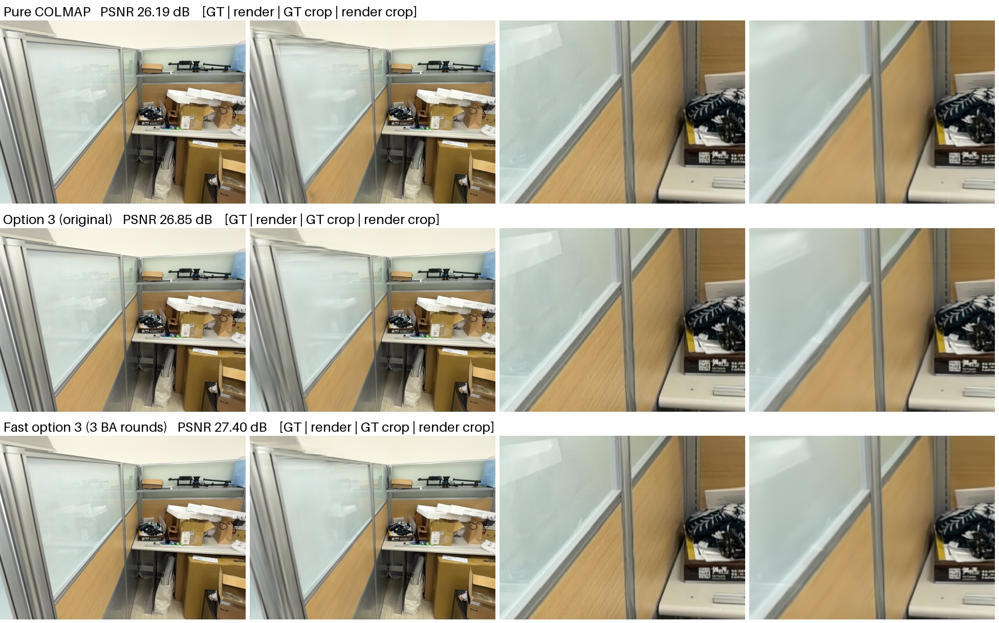
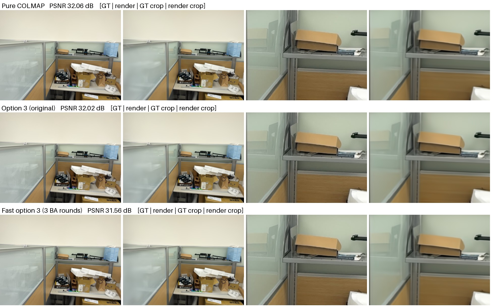
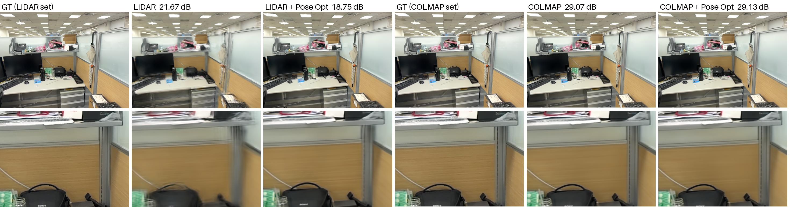
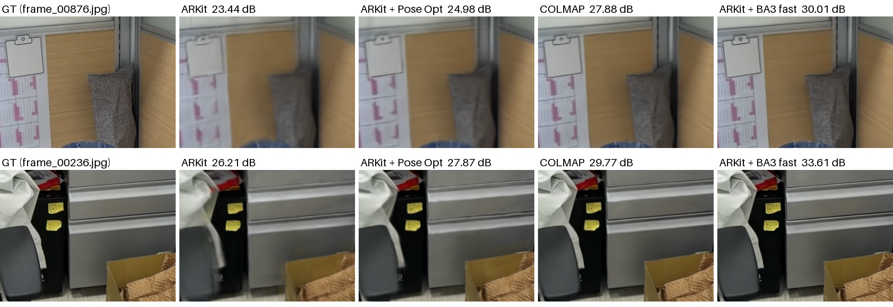
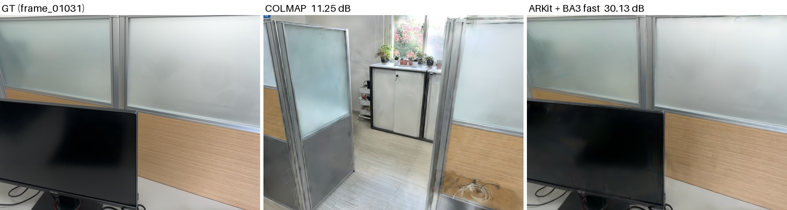

# 實驗數據

[English](benchmark.md) | **繁體中文**

## 關於這些數據

這些是作者在 2026 年 10 月開發這個工具時自己做的實驗。掃描資料本身沒有公開。這一節說明資料是怎麼拍攝、怎麼評估的，讓讀者能正確解讀數字，也能在自己的資料上重做同樣的評估。

### 掃描

| | 掃描 1(第一份) | 掃描 2(第二份) |
|---|---|---|
| 編號 | `scan_20261014_122607_B9A64C` | `scan_20261016_154038_063C40` |
| 用在 | 第 1–7 節和第 9 節 | 第 8 節和第 9 節 |
| 場景 | 室內辦公室 | 同一間辦公室 |
| 手機 | iPhone 18 Pro(`iPhone19,2`),iOS 27.0.1 | 同一支手機 |
| 擷取 App | [Splatify-Anything](https://github.com/KuoFengYuan/splatify-anything),邊走邊拍 | 同一個 App |
| 影像 | 1920×1440;拍了 749 張，保留 729 張有姿態的 | 1920×1440;拍了 1,562 張，保留 1,505 張有姿態的 |
| 拍攝時間 | 121 秒 | 237 秒 |
| 姿態 | ARKit 追蹤，再經擷取 App 在手機上優化 | 相同 |
| 3D 點 | 裝在同一個手持架上的外接 Livox Mid-360 LiDAR(250,000 點) | iPhone 內建 LiDAR(228,736 點) |
| 對焦 | 鎖定(fx 變動 0.13%) | 沒有鎖定(fx 變動 2.2%,見第 8.2 節) |

擷取 App 會丟掉無法定位的影像，只有有姿態的影像會被使用。

### 各組別的意思

- **ARKit 原始姿態**(也寫作「ARKit/LiDAR 原始姿態」、「純 ARKit」):直接用匯出的掃描訓練。它的 `sparse/0` 是 ARKit 軌跡再經 App 端上優化後的姿態，和 ARKit 軌跡本身相差中位數 4 mm(掃描 1)和 24 mm(掃描 2)。
- **ARKit + LichtFeld Pose Opt**:同樣的資料，訓練時開啟相機姿態優化。Pose Opt 是 LichtFeld Studio 的本地修改版功能，不在官方版本裡，這一組只供參考。
- **純 COLMAP**:不用輸入姿態，直接用 COLMAP 自己的流程(vocab tree 匹配加 global_mapper)處理同一批影像。
- **v1**:這個工具 10/15 的版本。OPENCV 相機模型，每輪 BA 跑到 COLMAP 預設的收斂條件。
- **v2**:10/16 的版本，也就是目前的預設。RAD_TAN_THIN_PRISM_FISHEYE 相機模型,BA 最多 15 次迭代，三角化內部 refinement 2 次。

### 評估條件

- **訓練**:LichtFeld Studio,MRNF 策略,30,000 iterations,`--max-cap 1000000`。
- **測試影像**:依檔名排序後每 8 張取 1 張當測試影像(掃描 1 是 729 張中的 92 張，掃描 2 是 1,505 張中的 189 張),所有組別完全相同。PSNR/SSIM/LPIPS 都是測試影像的平均值。第 9.2 節另外用了一種 held-out 切法，在該節說明。
- **誤差範圍**:同一個資料集重跑兩次訓練,PSNR 只差約 0.01 dB。整個 COLMAP 流程重跑一次再訓練，差約 0.05–0.09 dB(v1 在 10/15 是 28.448,10/16 用流程腳本重跑是 28.395;v2 在第一份掃描兩次獨立執行是 30.844 和 30.753)。所以 0.1 dB 以內視為誤差。
- **計時**:所有時間都是 COLMAP 各階段的實際經過時間，在同一台電腦(Core Ultra 7 265K、RTX 5070 12 GB)、GPU 閒置時量測。10/15 原始記錄的純 COLMAP 特徵擷取和匹配時間受當時 GPU 被其他工作佔用影響(特徵擷取記錄為 129 秒，閒置時重測只要 16 秒),下表已改用 10/16 重測的數字。

### 在自己的掃描上重做

1. 先直接用匯出的掃描訓練，當作基準:`"$LICHTFELD" --headless -d SCAN_DIR -o SCAN_DIR_train --max-cap 1000000 --eval --test-every 8`。
2. 執行 `./prior-pose-refine SCAN_DIR OUT_DIR`,再用同樣的選項訓練 `OUT_DIR/dataset`(見 [README](../README.zh-TW.md#6-訓練))。
3. 比較兩次的 `metrics_report.txt`。因為檔名沒有改變，兩次用的是同一批測試影像。

## 1. 姿態來源比較

| 姿態來源 | COLMAP 時間 | PSNR ↑ | SSIM ↑ | LPIPS ↓ |
|---|---|---|---|---|
| ARKit/LiDAR 原始姿態 | 0 | 23.459 | 0.8161 | 0.2743 |
| ARKit/LiDAR + LichtFeld Pose Opt | 0 | 25.701 | 0.8605 | 0.2113 |
| 純 COLMAP(vocab tree + global_mapper) | 7:36 | 28.232 | 0.9172 | 0.1507 |
| global_mapper + ARKit 重力 + 對齊(`--mode global` 的原型) | 約 7:44 * | 28.255 | 0.9173 | 0.1507 |
| ARKit 姿態 + vocab tree + BA × 3 | 約 6:51 * | 28.378 | 0.9177 | 0.1504 |
| v1(BA × 2) | 3:07 | 28.160 | 0.9140 | 0.1539 |
| v1(BA × 3) | 4:13 | 28.448 | 0.9184 | 0.1497 |
| v1(BA × 3),10/16 用流程腳本重跑 | 4:23 | 28.395 | 0.9178 | 0.1522 |
| v2 只有加速(`--camera-model OPENCV`) | 3:03 | 28.410 | 0.9179 | 0.1521 |
| v2,2 輪(`--rounds 2`) | 2:30 | 30.633 | 0.9491 | 0.1321 |
| **v2,3 輪 = 本工具預設** | **3:30** | **30.844** | **0.9504** | **0.1309** |

\* 特徵擷取和匹配換成重測的時間，其餘階段沿用原始記錄(原始記錄為 11:26、10:32)。

本工具的預設流程:

- 和純 COLMAP 相比:PSNR 高 2.61 dB(92 張全部變好),COLMAP 時間快 2.2 倍。
- 和 v1 相比:PSNR 高 2.45 dB(92 張全部變好),COLMAP 時間少 20%。
- v2 去畸變後的影像是 1880×1406,v1 是 1910×1429(邊緣多裁掉約 15 px)。只比較畫面中央 80% 時，差距是 +2.94 dB,所以提升不是來自邊緣裁切。

## 2. 各階段耗時(秒)

| 階段 | 純 COLMAP | v1 | v2 只有加速(OPENCV) | **v2(預設)** |
|---|---|---|---|---|
| 特徵擷取 | 16.3 | 15.5 | 15.9 | 15.9 |
| 挑選匹配對 | — | 6.8(ARKit + LiDAR 共視) | 4.9 | 4.9 |
| 匹配 | 164(vocab tree 50 張、guided) | 17.3(12,706 組，不開 guided) | 17.9 | 18.1 |
| 內參校正 | 30 | 不需要 | 不需要 | 不需要 |
| 求姿態 | 238(global_mapper) | 205(三角化 + BA × 3) | 137 | 161(三角化 79 + BA 82) |
| 對齊 + 去畸變 | 8 | 8.4 | 7.8 | 10.5 |
| **合計** | **456** | **253** | **183** | **210** |

和純 COLMAP 相比，省下的 246 秒有 57% 在匹配、44% 在求姿態，特徵擷取兩者一樣。

RAD_TAN_THIN_PRISM_FISHEYE 有 16 個參數,BA 每次迭代比 OPENCV 慢，去畸變也要多花約 3 秒，所以 v2 預設比「只有加速」的版本慢 27 秒。

## 3. 相機模型

### 3.1 OPENCV 的問題

把 v1 結果的重投影殘差依「到主點的距離」分組，看殘差在徑向上的平均值(正值代表投影點比觀測點更靠外)。v1 有明顯的系統誤差，而且隨半徑振盪，換成 RAD_TAN_THIN_PRISM_FISHEYE 後就消失了:

| 半徑(px) | OPENCV(v1) | RAD_TAN_THIN_PRISM_FISHEYE(v2) |
|---|---|---|
| 0–100 | +0.65 | −0.01 |
| 100–300 | +1.33 | −0.01 |
| 300–400 | +0.77 | +0.04 |
| 400–500 | −0.32 | −0.06 |
| 500–650 | −0.83 | +0.04 |
| 650–750 | −0.32 | −0.06 |
| 750–900 | +0.74 | +0.03 |
| 900–1000 | +0.36 | −0.06 |
| 1000–1100 | −0.89 | +0.01 |
| 1100 以上(角落) | −2.09 | −0.01 |

這是低階多項式硬去擬合高階曲線時，殘差會出現的典型形狀。實際的鏡頭畸變(v2 擬合結果，和同中心焦距的針孔相機相比，沿對角線)是:

| 半徑(px) | 200 | 400 | 600 | 800 | 1000 | 1150 |
|---|---|---|---|---|---|---|
| 畸變 | +0.56% | +1.80% | **+2.39%** | +2.09% | +1.87% | +1.44% |

畸變先升後降,OPENCV 的 k1 r² + k2 r⁴ 表達不了。

### 3.2 各相機模型比較

同一組匹配，前 2 輪用 OPENCV,後 2 輪換成各模型(初始值由 OPENCV 結果擬合而來)。殘留徑向誤差是半徑 1150 px 以內、每 50 px 一組的平均值中，絕對值最大的一組。

| 相機模型 | 畸變參數 | 重投影誤差 | 殘留徑向誤差 | PSNR |
|---|---|---|---|---|
| OPENCV(v1) | k1、k2 + 切向 2 項 | 1.149 px | 2.0 px | 28.395 |
| OPENCV_FISHEYE | θ 多項式 4 項 | 0.826 px | 0.32 px | 30.705 |
| THIN_PRISM_FISHEYE | θ 多項式 4 項 + 切向 + thin prism | 0.824 px | 0.32 px | 沒有訓練(殘差和 OPENCV_FISHEYE 幾乎相同) |
| FULL_OPENCV | 有理式 6 項 + 切向 | 0.823 px | 0.44 px | 沒有採用：係數發散(k2=63、k3=−77 互相抵消),BA 跑滿 100 次還沒收斂 |
| **RAD_TAN_THIN_PRISM_FISHEYE** | θ 多項式 6 項 + 切向 2 項 + thin prism 4 項 | **0.816 px** | **0.13 px** | **30.780**(v2 從第 0 輪就用這個模型:30.844) |

- 切向和 thin prism 項擬合出來幾乎都是 0(約 10⁻⁴),改進全部來自徑向的項數。
- OPENCV 多跑一輪(BA × 4)是 28.415 dB,只多 0.02 dB,所以提升來自相機模型，不是輪數。
- 從第 0 輪就用 RAD_TAN 收斂得比較快：第 1 輪的 BA 就大致擬合出畸變(重投影誤差 0.62 px),3 輪就到收斂值，不需要先跑 OPENCV。

### 3.3 剩下的誤差

把殘差分成「和畫面位置有關的系統誤差」(40×40 px 區塊的平均)和其餘部分:

| | v1(OPENCV) | v2 |
|---|---|---|
| 系統誤差(RMS) | 0.84 px | 0.10 px |
| 其餘部分(RMS) | 1.19 px | 1.09 px |

- v2 的相機模型已經沒有明顯的改進空間。
- 剩下的主要是特徵點定位的隨機誤差。
- 另有一個每張影像不同、和影像列(row)成線性的偏移，像是 rolling shutter 造成的：中位數約 0.1 px,最大的 5% 影像約 0.3–0.5 px。COLMAP 沒有 rolling shutter 模型，目前無法修正。

## 4. 加速方法的驗證

姿態差異的單位：中心位置 mm,旋轉 arcsec(1 px ≈ 149″),比較前先去掉整體的相似變換。

| 改動 | 每輪耗時 | 和原本設定比較的姿態差 |
|---|---|---|
| BA 最多 15 次迭代(原本 30–40 次) | BA 約 35 → 20 秒 | 0.00 mm,0.0″(完全相同;RAD_TAN 第 0 輪最大 4.6″) |
| BA 最多 10 次迭代 | BA 約 35 → 17 秒 | 最大 4.9″(RAD_TAN 第 0 輪最大 91″,沒有採用) |
| 三角化 refinement 2 次(原本 5 次) | 三角化 39.5 → 26.6 秒 | 中位數 3.7″,最大 24″ |
| 三角化 refinement 1 次 | 三角化 39.5 → 22.3 秒 | 中位數 9.4″,最大 44″(沒有採用) |

BA 停不下來的原因是 COLMAP 預設 `function_tolerance 0`,只靠梯度條件結束。改用 `function_tolerance 1e-6` 也可以提早停，但個別影像會差到 44″,不如固定迭代上限穩定。

**輪數和收斂**(OPENCV,以第 6 輪的結果當作收斂值，旋轉差的中位數):

| 輪數 | 1 | 2 | 3 | 4 | 5 |
|---|---|---|---|---|---|
| 和收斂值的差距 | 346″ | 110″ | 31″ | 11″ | 4″ |

每多一輪，差距大約縮小為三分之一。3 輪時已經在 0.2 px 以內，所以第 4 輪的 PSNR 沒有差別。

## 5. 試過但沒有採用的方法

| 方法 | 結果 | 原因 |
|---|---|---|
| 用 LiDAR 點雲取代 SfM 點雲當初始化 | −0.24 dB(v1 的兩種流程都一樣) | LiDAR 點和影像的一致性不如三角化出來的點 |
| COLMAP `spatial_matcher`(依相機位置挑選匹配) | −0.54 dB | 只看位置、不看朝向，有效匹配從 18,709 組降到 15,396 組 |
| BA 只做 1 輪 | −2.4 dB(v1,搭配 spatial 匹配) | 焦距和畸變還沒收斂 |
| BA 只做 2 輪 | v1:−0.29 dB;v2:−0.21 dB(快 60 秒) | 姿態還沒收斂。v2 保留成 `--rounds 2` 選項 |
| 增量式 `pose_prior_mapper` | 中止 | 80 秒只註冊 79 張，太慢 |
| 訓練縮短到 20k / 15k(`--steps-scaler 0.67 / 0.5`) | −0.23 / −0.44 dB | 省 4 / 6 分鐘，代價比改 COLMAP 大 |
| FULL_OPENCV 相機模型 | 係數發散 | 見 3.2 節 |
| BA 改用 CPU | 31 秒(GPU 是 27 秒) | 維持 GPU |
| COLMAP 的 CASPAR BA backend | 無法使用 | 本機的 COLMAP 編譯時沒有開 `CASPAR_ENABLED` |
| 第 0 輪三角化時順便修內參(`point_triangulator --refine_intrinsics 1`) | 三角化變慢(47 秒),2 輪後和收斂值的差距 100″(原本 110″) | 瓶頸是姿態收斂，不是內參 |
| 三角化不擷取顏色、限制內部 BA 迭代次數 | 時間沒有變化 | 這兩步本來就很快 |

## 6. 內參收斂

**v2(RAD_TAN_THIN_PRISM_FISHEYE)**。初始值用 tan θ 的泰勒展開，等同於沒有畸變的針孔相機。這類模型的 fx 是畫面中心的焦距，可以直接和 ARKit 比較:

| | fx | k0 | k1 |
|---|---|---|---|
| ARKit(初始) | 1371.6 | 0.333 | 0.133 |
| BA 第 1 輪 | 1366.3 | 0.583 | −0.028 |
| BA 第 2 輪 | 1366.4 | 0.618 | 0.062 |
| BA 第 3 輪 | 1366.8 | 0.619 | 0.074 |

**v1(OPENCV)**:

| | fx | k1 | k2 |
|---|---|---|---|
| ARKit(初始) | 1371.6 | 0 | 0 |
| BA 第 1 輪 | 1383.7 | 0.033 | −0.056 |
| BA 第 2 輪 | 1387.7 | 0.041 | −0.071 |
| BA 第 3 輪 | 1388.7 | 0.043 | −0.075 |
| 純 COLMAP 參考 | 1389.0 | 0.051 | −0.090 |

v1 的結論是「ARKit 焦距偏小約 1.3%」。但 v2 的中心焦距 1366.8 和 ARKit 的 1371.6 只差 0.35%:OPENCV 的 fx 偏大，是為了遷就它表達不了的畸變曲線。ARKit 資料真正缺少的是鏡頭畸變模型，這也是只靠 ARKit 姿態加 Pose Opt 訓練時品質差的主要原因。

## 7. 對照圖

每列從左到右:GT、render、GT 放大、render 放大。

含人物或名牌的對照圖保留在本機，不放入公開倉庫；對應數據與說明仍列在下方。

### v2 vs v1

**v2 領先最多(frame_00049,+4.98 dB)**:v1 的電話按鍵、夾板邊緣都糊掉了，v2 清楚。

*公開倉庫省略此圖，原圖保留在本機。*

**中位數(frame_00506,+2.47 dB)**:v2 的書背文字和條碼比較清楚。

*公開倉庫省略此圖，原圖保留在本機。*

**v2 領先最少(frame_00305,+0.17 dB)**:這張的 GT 本身有動態模糊，兩組都只有 21.6–21.8 dB。

*公開倉庫省略此圖，原圖保留在本機。*

### v1 vs 純 COLMAP

**v1 領先純 COLMAP 最多(frame_00145,+1.21 dB)**:純 COLMAP 在玻璃隔板上緣有重影。

**中位數(frame_00377)**

*公開倉庫省略此圖，原圖保留在本機。*

**v1 落後最多(frame_00105,−0.50 dB)**:三組都在 31.6–32.1 dB,肉眼幾乎看不出差別。

**ARKit 原始姿態 vs COLMAP(frame_00361)**:6 欄從左到右是 ARKit 資料的 GT、ARKit 姿態、ARKit + Pose Opt、COLMAP 資料的 GT、純 COLMAP、純 COLMAP + Pose Opt;下排是畫面中央的放大。ARKit 姿態訓練出來的結果有重影;開 Pose Opt 後變清楚，但畫面整體偏移。

## 8. 第二份掃描驗證

掃描 `scan_20261016_154038_063C40`:同一支 iPhone、同一間辦公室，改用 iPhone 內建 LiDAR。1,562 張影像，其中 1,505 張有 ARKit 姿態；測試影像 189 張(依檔名每 8 張取 1 張，四組相同)。訓練設定和第一份相同。

| | 第一份 | 第二份 |
|---|---|---|
| LiDAR | 外接 Livox Mid-360 | iPhone 內建 |
| 影像 / 有 ARKit 姿態 | 749 / 729 | 1,562 / 1,505 |
| 拍攝時間 / 移動距離 | 2 分鐘 / 25 m | 4 分鐘 / 63 m |
| ARKit 焦距變化 | 幾乎固定(±0.5 px) | 1368–1398 px(約 2.2%,沒有鎖定對焦) |

### 8.1 結果

| 姿態來源 | COLMAP 時間 | PSNR ↑ | SSIM ↑ | LPIPS ↓ |
|---|---|---|---|---|
| 純 ARKit | 0 | 23.137 | 0.8101 | 0.2870 |
| ARKit + LichtFeld Pose Opt | 0 | 24.974 | 0.8384 | 0.2450 |
| 純 COLMAP(vocab tree + global_mapper) | 17:47 | 28.281 | 0.9053 | 0.1657 |
| **v2(ARKit + BA3 fast)** | **7:30** | **30.554** | **0.9365** | **0.1419** |

- v2 比純 COLMAP 高 2.27 dB(189 張中 184 張變好),比純 ARKit 高 7.42 dB(189 張全部變好),比 ARKit + Pose Opt 高 5.58 dB。
- 只比較畫面中央 80% 時,v2 比純 COLMAP 高 2.47 dB。
- v2 重投影誤差 0.756 px,和畫面位置有關的系統誤差 RMS 0.09 px:RAD_TAN 相機模型在這份掃描同樣適用。
- 對齊後和 ARKit 的差距中位數是 2.4 cm(第一份 1.0 cm),純 COLMAP 也是 2.5 cm,代表這份掃描的 ARKit 姿態本身誤差比較大。

| 階段(秒) | 純 COLMAP | v2 |
|---|---|---|
| 特徵擷取 | 34 | 31 |
| 挑選匹配對 | — | 7 |
| 匹配 | 383(57,770 組，52% 通過驗證) | 52(29,976 組，84% 通過驗證) |
| 內參校正 | 41 | — |
| 求姿態 | 594(global_mapper) | 335(三角化 + BA × 3) |
| 對齊 + 去畸變 | 15 | 23 |
| **合計** | **1,067** | **450** |

### 8.2 對焦漂移的影響

這份掃描沒有鎖定對焦，焦距隨對焦距離變化。v2 和純 COLMAP 都讓所有影像共用一組焦距，純 ARKit 則每張都有自己的焦距。依 ARKit 焦距和中位數的差距分組:

| 焦距差距 | 測試影像 | 場景深度中位數 | v2 vs 純 COLMAP | v2 vs 純 ARKit |
|---|---|---|---|---|
| 0–0.3% | 122 | 約 1.2 m | +2.32 dB | +7.75 dB |
| 0.3–0.6% | 42 | 約 1.3 m | +2.87 dB | +7.86 dB |
| 0.6–1.0% | 11 | 約 0.8 m | +1.42 dB | +4.79 dB |
| 1.0% 以上 | 14 | 約 0.6 m | +0.73 dB | +5.26 dB |

焦距偏離大的多半是近拍(對焦近，焦距變大),v2 的優勢在這些影像上明顯縮小。這些影像本身也比較難，所以影響不全是焦距造成的。建議拍攝時鎖定對焦；或在 BA 時依 ARKit 每張的焦距比例調整(尚未實作與驗證)。

### 8.3 對照圖

**畫面中央放大**:由左至右是 GT、純 ARKit、ARKit + Pose Opt、純 COLMAP、v2。上排 frame_00876(v2 比 COLMAP +2.13 dB,中位數),下排 frame_00236(+3.84 dB,前 10%)。純 ARKit 那一欄用未去畸變的原圖，取景略有不同。

**純 COLMAP 的失誤(frame_01031)**:COLMAP 把這台相機放到房間的另一個位置(11.25 dB),v2 從 ARKit 姿態出發，位置正確(30.13 dB)。場景裡有很多長得很像的玻璃隔板，從零求解時可能因此配錯。189 張中有 4 張 COLMAP 落後 v2 5 dB 以上;v2 最多只落後 COLMAP 0.69 dB。

## 9. 初始點雲與 floater

同一次 v2 結果，只換訓練的初始點雲，都用 `--max-cap 1000000`。用每張影像的 LiDAR 深度判斷高斯的位置:**房間內懸空的 floater** = 在 LiDAR 點雲範圍內、周圍 30 cm 沒有任何 LiDAR 點、不透明度 > 0.1 的高斯。

| 指標 | 第二份 SfM | 第二份 LiDAR | **第二份 SfM + LiDAR** | 第一份 SfM | **第一份 SfM + LiDAR** |
|---|---|---|---|---|---|
| PSNR ↑ | 30.54 | 29.16 | **30.51** | 30.75 | **30.77** |
| LPIPS ↓ | 0.142 | 0.160 | **0.139** | 0.131 | **0.129** |
| LPIPS 變好的張數(對 SfM) | — | 38/189 | **139/189** | — | **64/92** |
| 房間內懸空的 floater | 5,990 | 956 | **3,544** | 12,898 | **4,216** |
| floater 佔畫面份量 | 2.2% | 1.6% | **1.4%** | 16.0% | **4.3%** |

- SfM + LiDAR 合併(`--init-points merge`,10/19 起為預設):兩份掃描的 PSNR 都持平，LPIPS 都變好，懸空 floater 少 41% / 67%。
- 只用 LiDAR 點:幾何最乾淨，但 PSNR 少 1.4 dB。LiDAR 點是用 ARKit 原始姿態拼成的，和優化後的相機差約 2.4 cm(第二份),也抓不到細小物體。
- 第一份的「表面前方」floater 判斷不可靠:Mid-360 點雲本身就有 18.8% 被判成懸空(第二份的 iPhone LiDAR 是 1.2%),所以上表第一份只用「離 LiDAR 點雲 30 cm 以上」這項指標。

**點雲不夠密的原因**(第二份,SfM 初始化):高斯數量在第 3,100 步(共 30,000 步)就達到 100 萬上限，之後無法再增加；SfM 初始點只覆蓋 58% 的 LiDAR 表面(5 cm 以內),地板只有 9%。

**floater 的來源**:霧面玻璃隔板前後(約 6,000 個不透明高斯)、窗外景物(約 4.5 萬個高斯在房間外 1 m 以上)、6% 懸空的 SfM 初始點、沒有深度監督。每個表面點平均有 79 張訓練影像看到，所以不是視角不足。盆栽、環形燈這類細小物體 LiDAR 量不到，會被誤判為懸空。

### 9.1 白牆、地板等無紋理表面

無紋理表面 = LiDAR 表面中 10 cm 內沒有任何 SfM 點的部分(第二份 21%、第一份 59%)。高斯只計不透明度 > 0.1 的；PSNR 只計測試影像上投影到這些表面的像素。

| 指標 | 第二份 SfM | 第二份 SfM + LiDAR | 第一份 SfM | 第一份 SfM + LiDAR |
|---|---|---|---|---|
| 3 cm 內有高斯 | 7.3% | 88.6% | 2.9% | 54.6% |
| 10 cm 內有高斯 | 41.3% | 98.9% | 29.4% | 88.4% |
| 到最近高斯的距離(中位數) | 11.8 cm | 1.0 cm | 14.8 cm | 2.7 cm |
| 這些區域的 PSNR | 31.75 | 31.61 | 30.43 | 30.48 |

以第二份掃描一面 80 × 80 cm、前方沒有物體的白牆為例：只用 SfM 點時，牆面 ±3 cm 內 0 個高斯，前後 1 m 內只有 7 個、每個約 13 cm;加入 LiDAR 點後，牆面 ±3 cm 內 1,084 個、每個約 2.7 cm。從拍攝路徑看畫質差不多，但只用 SfM 點時牆面幾乎沒有幾何，換角度看或匯出點雲時才看得出差別。

### 9.2 渲染深度對照 LiDAR,以及沒拍過的角度

GT 深度 = 每張影像的 iPhone LiDAR 深度(信心 2、非深度邊緣),用 ARKit 姿態反投影，再以 ARKit → 模型的相似轉換對到模型座標(和 SfM 點比對：中位數 +0.4 cm、MAD 2.7 cm)。渲染深度 = gsplat 的期望深度。「透空」= 渲染表面比 LiDAR 深 10 cm 以上或不透明度 < 0.5;「牆前」= 淺 10 cm 以上;「正確」= ±10 cm 內。只統計無紋理表面(定義同 9.1)。

測試影像(每 8 張一張，第二份 189 張、第一份 92 張):

| 白牆 | 第二份 SfM | 第二份 SfM + LiDAR | 第一份 SfM | 第一份 SfM + LiDAR |
|---|---|---|---|---|
| 深度正確 | 27% | 55% | 19% | 56% |
| 透空 | 67% | 27% | 65% | 21% |
| 牆前 | 7% | 18% | 16% | 22% |
| 深度誤差中位數 | 38.7 cm | 8.3 cm | 37.6 cm | 8.4 cm |
| PSNR | 32.60 | 32.59 | 32.96 | 32.89 |

沒拍過的角度：每 128 張拿掉連續 16 張不參與訓練(第二份 192 張、第一份 96 張),不帶 `--eval` 訓練，再用 gsplat 渲染這些角度；每張渲染各自做一次每通道的增益/偏移校正(訓練沒看過這些影像的曝光)。每組訓練兩次取平均，兩次的 PSNR 差 < 0.05 dB。

| 指標 | 第二份 SfM | 第二份 SfM + LiDAR | 第一份 SfM | 第一份 SfM + LiDAR |
|---|---|---|---|---|
| 白牆透空 | 64% | 14% | 57% | 22% |
| 白牆深度正確 | 29% | 58% | 23% | 48% |
| 白牆前 | 8% | 28% | 20% | 30% |
| PSNR(整張) | 24.39 | 24.57 | 24.13 | 23.60 |
| PSNR(無紋理) | 26.88 | 27.01 | 25.28 | 24.36 |
| LPIPS | 0.132 | 0.129 | 0.124 | 0.125 |

- 幾何的改善在兩份掃描、兩種評估方式都一致；畫質沒有跟著變好。
- 牆前多出和牆同色的 floater,從拍過的角度看不出來，所以 PSNR 抓不到。要去掉需要訓練時的 LiDAR 深度約束。
- 第一份的 −0.5 dB 集中在大辦公室看遠處天花板的兩段(各約 −1 dB),天花板出現沒有高斯的破洞；其餘 4 段 +0.1 到 +0.6 dB。已排除 LiDAR 對不準(與 SfM 點偏差 0.1–0.3 cm),也已排除照片看不到的 LiDAR 點：Mid-360 有 29% 的點少於 5 張照片看到(第二份的 iPhone LiDAR 只有 0.1%),但只加 3 張以上照片看得到的點(保留 75%),PSNR 一樣是 23.61。
- 先試過拿掉一整段連續 12.5% 的拍攝路徑，不採用：那段是只走過一次的隔間，兩種初始點雲都只有 14–15 dB,而且 LiDAR 點本身帶有那段影像的深度。另外 LichtFeld 對沒訓練過的影像，曝光是用名稱排序前後的訓練影像內插的，改名重排會讓曝光錯掉。
